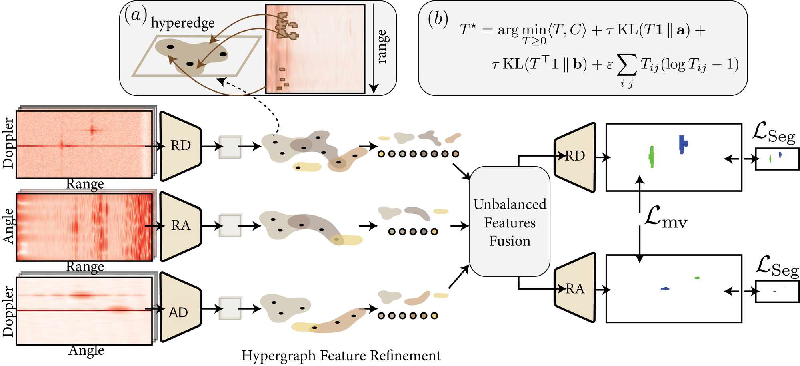
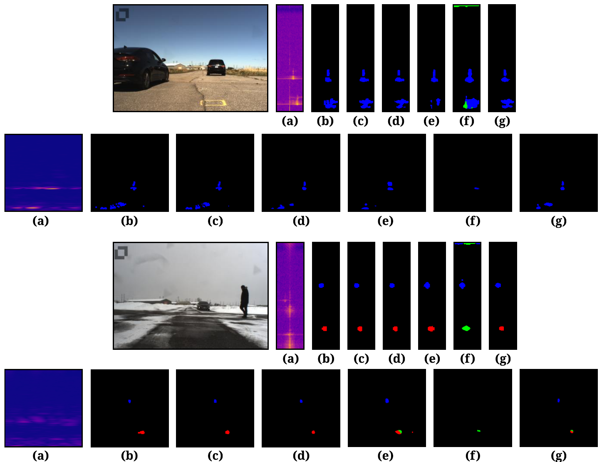

<div align="center">

<h1>HyperRadar: Learning Structurally Consistent Representations for Multi-View Radar Semantic Segmentation</h1>
<p>
  <a href="https://scholar.google.com/citations?user=BVBJ06QAAAAJ">Ali Zia</a> †*<sup>1,2</sup>,
  <a href="https://scholar.google.com/citations?user=D3AhoccAAAAJ">Muhammad Umer Ramzan</a> *<sup>3</sup>,
  Abdelwahed Khamis<sup>4</sup>,
  <a href="https://scholar.google.com/citations?user=2A32xVQAAAAJ">Usman Ali</a><sup>3</sup>,
  <a href="https://scholar.google.com/citations?user=ZTuS-yUAAAAJ">Abdul Rehman</a><sup>3</sup>
</p>
<p>
  <sup>1</sup> School of Computing, Engineering and Mathematical Sciences, La Trobe University, Melbourne, Australia<br>
  <sup>2</sup> La Trobe Institute for Sustainable Agriculture &amp; Food (LISAF), Australia<br>
  <sup>3</sup> School of Engineering and Applied Sciences, GIFT University, Pakistan<br>
  <sup>4</sup> Commonwealth Scientific and Industrial Research Organisation (CSIRO), Australia<br>
  * Equal contribution &nbsp;·&nbsp; † Corresponding author
</p>

<a href="https://eccv.ecva.net/virtual/2026/poster/5805">
  
</a>
<a href="https://arxiv.org/abs/2606.31609">
  
</a>
<a href="https://arxiv.org/pdf/2606.31609">
  
</a>
<a href="https://ali-zia.me">
  
</a>
<a href="LICENSE">
  
</a>

<p>Official code for the ECCV 2026 paper <a href="https://eccv.ecva.net/virtual/2026/poster/5805"><i>Learning Structurally Consistent Representations for Multi-View Radar Semantic Segmentation</i></a>.</p>
</div>

## 🧠 Overview

Radar keeps working in rain, fog and darkness, which makes it one of the most dependable sensors for autonomous driving. Its measurements are sparse, noisy and carry little semantic detail, though, so dense segmentation is hard. A single car or pedestrian shows up as a scattered group of returns, and most radar segmentation networks only model grid neighbourhoods or pairwise interactions, which misses that group structure. On top of that, the range–Doppler (RD), range–angle (RA) and angle–Doppler (AD) views describe the same scene on different axes, with no pixel-to-pixel correspondence between them.

HyperRadar is built around higher-order structure and alignment between views:

- **Learnable hypergraphs inside each view.** Every feature location is softly assigned to a small set of hyperedges, so returns from the same physical object exchange information as a group rather than only with their immediate neighbours.
- **Cross-view unbalanced optimal transport (UOT).** View-specific features are aligned with a generalised Sinkhorn solver. UOT needs no explicit correspondences and copes with mass that appears in one view but not another, which happens constantly in radar because of different measurement densities and partial observations.
- **Adaptive attention for fusion.** Cascaded channel gates fuse the complementary views and emphasise the structurally informative responses. The network is trained with supervised segmentation losses together with a cross-view consistency term.

HyperRadar sets a new state of the art on **CARRADA (63.8% RD mIoU, 44.4% RA mIoU)** and **RADIal (83.4% mIoU)**, and does so with slightly less computation and memory than TransRadar.

---

## 🏗️ Architecture

<p align="center">
  
</p>

The three radar views (RD, RA, AD) are processed by independent encoders and refined by view-specific learnable hypergraphs. **(a)** For an extended object such as a car, whose reflections spread over several range cells, the hypergraph captures these non-local dependencies and groups them into one hyperedge. **(b)** Unbalanced optimal transport then aligns the refined features across views. The fused tokens pass through adaptive attention and are decoded into dense RD and RA masks. The whole network is trained end to end with segmentation losses (ℒ<sub>Seg</sub>) and a cross-view consistency loss (ℒ<sub>mv</sub>).

| Component | Paper | Code |
|---|---|---|
| Per-view projection | Eq. 1 | `TransRad.rd_project`, `ra_project`, `ad_project` in [`mvrss/models/TransRadar.py`](mvrss/models/TransRadar.py) |
| Learnable hypergraph | Eq. 2 | `LearnableHypergraph` in [`mvrss/models/hyperradar_blocks.py`](mvrss/models/hyperradar_blocks.py) |
| Unbalanced OT (generalised Sinkhorn) | Eqs. 3–4 | `GeneralizedSinkhorn` |
| Cross-view transfer with learnable β | Eq. 5 | `CrossViewUOT` |
| Adaptive channel gating | Eq. 6 | `ChannelGate` |
| RD / RA decoders | Eq. 7 | `TransRad` decoder branches |
| Training objective | ℒ<sub>Seg</sub>, ℒ<sub>mv</sub> | `HyperRadarConsistency` in [`mvrss/losses/HyperRadarLoss.py`](mvrss/losses/HyperRadarLoss.py), wired up in `define_loss` ([`mvrss/utils/functions.py`](mvrss/utils/functions.py)) |

---

## 📈 Results

### CARRADA (test split)

IoU and Dice in %. The full table, including FCN-8s, U-Net, DeepLabv3+, RSS-Net, RAMP-CNN and MVNet, is in the paper.

| View | Method | Ped. IoU | Cycl. IoU | Car IoU | **mIoU** | **mDice** |
|---|---|---|---|---|---|---|
| RD | TMVA-Net | 52.6 | 29.0 | 53.4 | 58.7 | 70.9 |
| RD | PeakConv | – | – | – | 60.7 | 72.5 |
| RD | TransRadar | 56.7 | 30.2 | 61.7 | 62.1 | 73.4 |
| RD | **HyperRadar** | **59.2** | **32.4** | **63.8** | **63.8** | **75.2** |
| RA | TMVA-Net | 26.0 | 8.6 | 30.7 | 41.3 | 51.0 |
| RA | PeakConv | – | – | – | 42.9 | 53.3 |
| RA | TransRadar | 29.9 | 6.5 | 35.3 | 42.9 | 52.6 |
| RA | **HyperRadar** | **31.8** | 8.4 | **37.5** | **44.4** | **54.3** |

### RADIal

| Backbone | AP (%) ↑ | AR (%) ↑ | Range error (m) ↓ | Angle error (°) ↓ | mIoU (%) ↑ |
|---|---|---|---|---|---|
| Pixor | 96.6 | 81.7 | 0.10 | 0.20 | – |
| FFTRadNet | 96.8 | 82.2 | 0.11 | 0.17 | 74.0 |
| C-M DNN | 96.9 | 83.5 | – | – | 80.4 |
| TransRadar | 97.3 | 98.4 | 0.11 | 0.10 | 81.1 |
| **HyperRadar** | **98.5** | **98.9** | **0.10** | **0.08** | **83.4** |

### Ablation on CARRADA (mIoU %)

| Hypergraph | UOT | Attention | RD | RA | Avg. |
|---|---|---|---|---|---|
| – | – | ✓ | 62.1 | 42.9 | 52.5 |
| – | ✓ | – | 61.7 | 42.2 | 52.0 |
| – | ✓ | ✓ | 62.4 | 43.1 | 52.8 |
| ✓ | – | – | 61.9 | 42.4 | 52.2 |
| ✓ | – | ✓ | 62.5 | 43.3 | 52.9 |
| ✓ | ✓ | – | 63.0 | 43.7 | 53.4 |
| ✓ | ✓ | ✓ | **63.8** | **44.4** | **54.1** |

The hypergraph improves structure within each view and UOT improves agreement between views, so the two help most together. Results are stable across UOT settings (ε from 0.01 to 0.10, τ from 0.5 to 1.0), with the defaults ε = 0.05 and τ = 0.8 performing best.

### Cost

| Model | GFLOPs | FPS | Peak GPU memory |
|---|---|---|---|
| TransRadar | 1138.57 | 9.6 | 3.25 GB |
| **HyperRadar** | **1132.13** | **10.55** | **3.18 GB** |

### Qualitative results

<p align="center">
  
</p>

Two CARRADA test scenes, each with the camera image, the RD view (top row) and the RA view (bottom row). (a) radar input, (b) ground truth, (c) **HyperRadar**, (d) TransRadar, (e) TMVA-Net, (f) MVNet, (g) U-Net. Blue is car, green is cyclist, red is pedestrian. HyperRadar keeps the main object response intact, avoids scattered false positives, and separates the pedestrian and car cleanly in the harder snowy scene.

---

## ⚙️ Environment

The code was developed with Python 3.10, PyTorch 1.12.1 and CUDA 11.3 on Linux.

```bash
conda env create -f env.yml
conda activate HyperRadar
pip install -e .
```

---

## 📊 Data

This release trains and evaluates on [CARRADA](https://github.com/valeoai/carrada_dataset). Download and extract it so that the folder layout is:

```
/path/to/datasets/
└── Carrada/
    ├── 2019-09-16-12-52-12/
    ├── ...
    ├── data_seq_ref.json
    └── light_dataset_frame_oriented.json
```

Then tell the code where the data lives and where to write logs (this writes `mvrss/config_files/config.ini`):

```bash
cd mvrss
python -m utils.set_paths --carrada /path/to/datasets --logs /path/to/logs
```

---

## 🚀 Training and testing

All hyperparameters live in [`mvrss/config_files/HyperRadar.json`](mvrss/config_files/HyperRadar.json): 300 epochs, batch size 6, learning rate 1e-4, five input frames, and the `HyperRadar` loss.

```bash
cd mvrss
python -u train.py --cfg ./config_files/HyperRadar.json --cp_store /path/to/checkpoints
```

Training writes a copy of the config into the log folder. Point the test script at it:

```bash
cd mvrss
python -u test.py --cfg /path/to/logs/carrada/TransRadar/TransRadar_0/config.json
```

`train_transrad.sh` and `test_transrad.sh` (run from inside `mvrss/`) wrap the same steps; set `DATA_DIR` at the top of each before running. Add `--unit_test` to `train.py` for a one-batch dry run.

Hypergraph and transport settings (8 hyperedges, ε = 0.05, τ = 0.8, 30 Sinkhorn iterations, a 16×16 transport grid) are constructor defaults of `TransRad`, so they can be changed there without touching the training scripts.

---

## 📁 Repository layout

```
fig/                architecture and qualitative figures
mvrss/
├── config_files/   HyperRadar.json, dataset statistics, path config
├── learners/       training loop, testing and initialisation
├── loaders/        CARRADA dataset and data loaders
├── losses/         HyperRadar consistency loss, soft Dice, coherence
├── models/         HyperRadar (TransRadar.py), its blocks and baseline models
├── utils/          metrics, paths, TensorBoard visualiser
├── train.py
└── test.py
```

---

## 🙏 Acknowledgements

The training and evaluation pipeline is built on [MVRSS](https://github.com/valeoai/MVRSS) (Ouaknine et al., ICCV 2021) and [TransRadar](https://github.com/YahiDar/TransRadar) (Dalbah et al., WACV 2024). HyperRadar reuses their encoder and decoder design and keeps their training interface, so configs and scripts from those projects work the same way here. We thank the authors for releasing their code and the CARRADA dataset.

---

## 📖 Citation

If you find this code useful, please cite:

```bibtex
@inproceedings{zia2026hyperradar,
  title     = {Learning Structurally Consistent Representations for Multi-View Radar Semantic Segmentation},
  author    = {Zia, Ali and Ramzan, Muhammad Umer and Khamis, Abdelwahed and Ali, Usman and Rehman, Abdul},
  booktitle = {Proceedings of the European Conference on Computer Vision (ECCV)},
  year      = {2026},
  note      = {arXiv:2606.31609}
}
```

## 📄 License

Released under the [Apache License 2.0](LICENSE), the same licence as the MVRSS code this project builds on.
